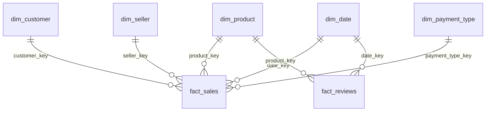

# Star schema

draw.io is a desktop app, so I drew this as a Mermaid diagram. It shows the same thing: one fact table in the middle with five dimensions around it.

The `||--o{` symbol means "one dimension row connects to many fact rows". For example, one customer can have many sales rows.

`fact_reviews` sits next to the star because it answers different questions (see `fact_reviews.md`).
